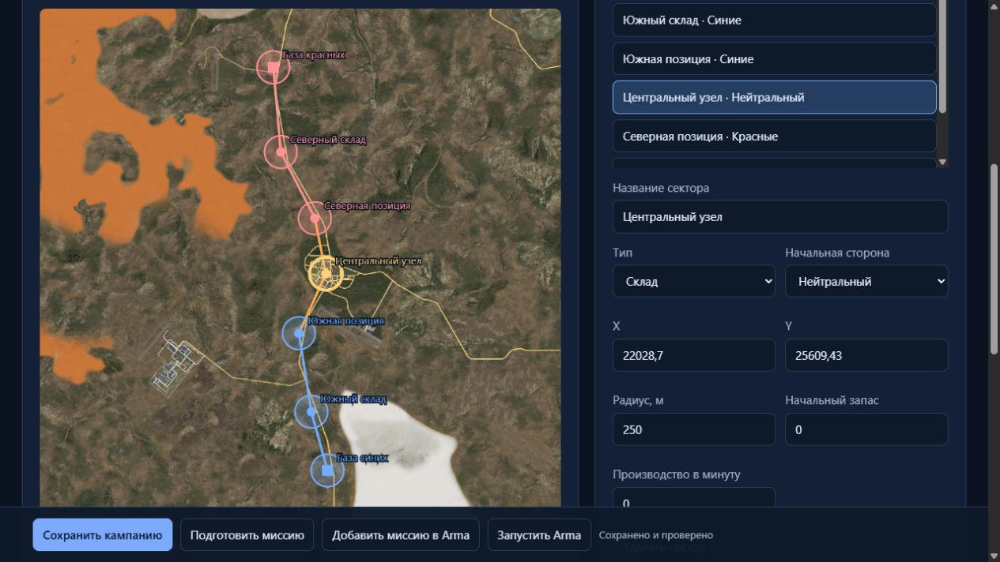

# NeroAI Operations: кампания с линией фронта и снабжением

Состояние на **12.10.2026, Europe/Kiev**. Рабочий проект — `C:\Users\Admin\Desktop\ИИ\NeroAI_Warlords_DualLLM`. Разработка началась 11 октября; каталог доказательств `dist/operations-campaign-20261011` сохраняет дату начала работы. Исторический cwd `NeroAI_4.2.0-takistan-rp` не является источником Operations.

Первый вариант подготовлен для **Australia**, роль игрока — **командир наземного отряда**. Редактор, генератор, правила кампании и соответствие установленного пакета исходникам проверены. Проезд колонн, загрузка сохранения, визуальный Zeus и медицинские действия ACE в этой миссии ещё не приняты в движке Arma.

## Открытие редактора и запуск миссии

[Открыть готовую кампанию](http://127.0.0.1:18786/campaign?id=5fbba839-4303-4b7d-bdc5-7ca7441cfb77). Общий вход — [Кампания и снабжение](http://127.0.0.1:18786/campaign). Ссылки на кампанию добавлены в воздушный и наземный редакторы Operations. В библиотеке находятся все три типа сценариев; кнопка «Открыть» выбирает соответствующий редактор.

1. Для изменения конфигурации использовать вкладки **Кампания**, **Армии**, **Снабжение**, **Фронт и карта**. **Сохранить кампанию** сохраняет конфигурацию редактора; игровой прогресс сохраняется отдельно во время миссии.
2. После изменения настроек нажать **Добавить миссию в Arma**. Кнопка сохраняет текущую конфигурацию, собирает, проверяет и добавляет отдельный PBO. **Подготовить миссию** только создаёт проверенную сборку.
3. Для игры с нужными модами использовать **Запустить Arma** из редактора этой кампании. Автоматический запуск игры в ходе данной разработки не выполнялся.
4. В Arma выбрать **Мультиплеер → Создать сервер → Australia → NeroAI — Australia: линия фронта и снабжение [FRONT TEST 3]**. Если новой строки нет, переключить карту и вернуться на Australia.
5. Занять **первого командира синих**. Свободные командирские слоты можно оставить AI, включив ботов штатным управлением лобби. До начала миссии выбрать параметр **Прогресс кампании → Продолжить сохранённую** либо **Начать новую**.

При первом запуске «Продолжить сохранённую» создаёт новую кампанию, поскольку сохранения ещё нет. При выборе «Начать новую» следующая успешная запись заменяет прогресс именно этой конфигурации. Для независимой войны сначала использовать **Сохранить копию** в редакторе.

Запуск локального сервиса без открытия игры: `control-center\operations-start.ps1 -NoBrowser -Page campaign`. Не запускать второй экземпляр при работающем сервисе на порту 18786. Существующий помощник ярлыка Operations ранее был отклонён автоматической проверкой разрешений; обходить это отклонение другим инструментом нельзя. Прямая ссылка редактора проверена.

## Настройки готового варианта

| Параметр | Значение |
| --- | --- |
| Карта / район | Australia / сеть позиций у Alice Springs |
| Роль / сторона | Командир отряда / синие |
| Командирские слоты | По 2 на сторону, всего 4; допускают игроков и AI |
| Начальные силы | По 3 отряда из 6 обычных AI; командиры добавляются отдельно |
| Резерв | По 24 дополнительных отряда; всего 27 отрядов на сторону за кампанию |
| Начальное снабжение | По 840 единиц в связанных секторах до покупки начальных отрядов |
| Цена подкрепления / захвата | 50 / 40 единиц снабжения |
| Захват | 120 секунд без присутствия противника, со связью до базы и запасом у соседнего сектора |
| Колонны | По одной одновременно на сторону; груз 120, интервал автоматического запроса 90 секунд, срок доставки 600 секунд |
| Подкрепления | Проверка пополнения раз в 60 секунд при свободном месте, снабжении и резерве |
| Сессия | 90 минут, начало в 09:00, облачность 0,15 |
| Сохранение | Включено; первое через примерно 5 секунд после готовности, затем раз в минуту и по действию игрока |

Синие используют четыре типа пехоты RHSUSAF, красные — четыре типа RHSAFRF. Грузовики — `CUP_B_Ural_CDF` и `CUP_O_Ural_RU`. В список запуска входят 8 установленных модов: Australia FIXED, ACE, CBA A3, RHSUSAF, RHSAFRF, CUP Vehicles, CUP Units и CUP Weapons. Проверка сборки подтвердила наличие классов и зависимостей; совместимость поведения этих модов проверяется в игре.

Сеть состоит из семи секторов и шести последовательных связей:

| ID | Сектор | Сторона | Начальный запас | Производство / мин | X, Y | До дороги по данным карты, м |
| --- | --- | --- | ---: | ---: | --- | ---: |
| S0 | База синих | Синие | 600 | 40 | 22052.59, 22598.57 | 80.00 |
| S1 | Южный склад | Синие | 150 | 10 | 21806.21, 23497.18 | 80.01 |
| S2 | Южная позиция | Синие | 90 | 0 | 21615.34, 24699.77 | 80.00 |
| S3 | Центральный узел | Нейтральный | 0 | 0 | 22028.70, 25609.43 | 13.56 |
| S4 | Северная позиция | Красные | 90 | 0 | 21859.82, 26460.18 | 80.00 |
| S5 | Северный склад | Красные | 150 | 10 | 21338.54, 27474.31 | 80.00 |
| S6 | База красных | Красные | 600 | 40 | 21224.11, 28770.45 | 77.32 |

Радиус каждого сектора — 250 м. Расстояния рассчитаны по извлечённой геометрии установленной карты: 35 111 дорожных отрезков. Наличие отрезка возле сектора не доказывает связность `roadsConnectedTo` и успешное вождение AI.

## Фронт, снабжение и отряды

Захват разрешён на соседнем участке фронта, доступном от собственной базы через свои секторы. Оба присутствующих противника замораживают прогресс. Пустая, защищённая или лишённая снабжения зона теряет накопленный прогресс. Расход на захват фиксируется один раз при смене владельца; новый сектор получает нулевой запас.

База и склады производят ресурсы только при связи со своей базой. Вместимость — 5 000 единиц на сектор. Позиции и города не производят снабжение. После захвата нейтрального узла можно доставить ресурсы; производство зависит от заданной в редакторе величины и в готовой конфигурации S3 равно нулю.

Колонна — настоящий грузовик с водителем и грузом в учёте кампании. Перед отправкой требуется свой связанный маршрут по секторам, дорожный путь, свободный лимит и запас на исходной базе. Ресурсы списываются при успешной отправке, начисляются только после прибытия живого грузовика в сектор назначения. Потеря грузовика/водителя, истечение времени или переход участка маршрута противнику уничтожают груз. Повторный учёт одной доставки исключён.

Маршрутизатор использует дорожные объекты Arma и ограниченный поиск по их связям. Длинного обхода через бездорожье при отсутствии дороги нет. Короткий последний участок до центра сектора допускается. Рабочая дорожная сеть карты и фактическое движение транспорта требуют проверки в движке.

Отряды пополняются только до заданного активного лимита, расходуя снабжение и конечный резерв. Часть AI защищает свои позиции, остальные идут к фронту. Игрок управляет своим отрядом штатными командами Arma; автоматические приказы не меняют маршрут группы с живым игроком. Командирский бот лобби получает отдельный доступный отряд. Резерв относится к обычным отрядам, водители снабжения и командирские слоты учитываются отдельно.

В миссии есть HUD с секторами, отрядами, резервом, ближайшим запасом, колоннами, временем сессии и результатом сохранения. Действия: **Получить отряд**, **Запросить снабжение в ближайший сектор**, **Сохранить кампанию**, **Открыть Zeus**. Захват главной базы противника завершает кампанию победой; окончание времени сессии сохраняет продолжающуюся кампанию.

Zeus подключён общими функциями для всех ролей; ACE + CBA обязательны. Созданные через Zeus произвольные отряды, техника и укрепления пока не входят в сохранение и штатный учёт резервов/захвата кампании.

## Что сохраняется

В профиле сервера сохраняются владельцы секторов, снабжение, прогресс захвата, израсходованные резервы, накопленное время, победитель, выжившие классы/позиции обычных AI, назначение охраны/наступления и находящийся в пути груз с оставшимся сроком доставки. Восстановление группы не покупает её второй раз и не возвращает уже использованные резервы. Восстановленный груз не списывается повторно.

Это стратегическое сохранение и восстановление состава. Боезапас, ранения ACE, экипировка и точное положение каждого человека, объекты Zeus, повреждения и грузы в инвентаре машины не являются полным снимком мира. AI создаётся с исходным снаряжением; восстановление недоставленного груза зависит от найденного дорожного маршрута. Если маршрут восстановить нельзя, груз считается потерянным. Время новой сессии начинается заново; накопленное время кампании сохраняется отдельно.

Хранилище — `missionProfileNamespace`, запись вызывается только сервером через `saveMissionProfileNamespace`. Каждая самостоятельная копия редактора получает собственный ключ. Имя миссионной группы связывает сборки одного набора игровых настроек; переименование и исправление кода сохраняют область прогресса, изменение игровых настроек создаёт другую область. Это соответствует механизму [missionGroup и saveMissionProfileNamespace у Bohemia](https://community.bistudio.com/wiki/saveMissionProfileNamespace).

Отсутствие файла при первом запуске является нормальным: файл создаёт первая успешная запись. Проверка `isMissionProfileNamespaceLoaded` до первой записи не должна запрещать сохранение. Начальное чтение выполняется после того, как движок загружает имеющиеся переменные до init; см. [официальное описание команды](https://community.bistudio.com/wiki/isMissionProfileNamespaceLoaded).

Для готового варианта группа — `NeroOP_Front_d142bbeea38642379905e2f26306cffe_2e16691bdd21`, ожидаемое имя файла — `NeroOP_Front_d142bbeea38642379905e2f26306cffe_2e16691bdd21.vars` в профиле хоста. Фактическое создание этого файла ещё не проверено в Arma. При продолжении нужно использовать тот же серверный профиль. Перед ручным выходом из сессии использовать действие **Сохранить кампанию** и дождаться успешного сообщения; при аварийном выходе остаётся последняя успешная запись.

Сохранённые данные проходят проверку типов, диапазонов, количества групп, потраченных резервов, классов своей стороны и подписи конфигурации. Сохранённый текст не исполняется. Повреждённое или несовместимое сохранение вызывает видимое сообщение и старт новой кампании.

## Готовая сборка и доказательства

- Запись: `5fbba839-4303-4b7d-bdc5-7ca7441cfb77`, версия **3**, ключ `d142bbee-a386-4237-9905-e2f26306cffe`.
- Установлено: `H:\SteamLibrary\steamapps\common\Arma 3\MPMissions\NeroAI_Frontline_Australia_c2ef943078f4.australia.pbo`.
- Исходная папка сборки: `dist/operations/NeroAI_Frontline_Australia_c2ef943078f4.australia`.
- SHA256: `4FEF8A980F283F8A9BDFE7D6314F4CF75F5222D0A46BAB5006C9FDC475A64105`.
- Пакет: **29 файлов**, **23 SQF функции**, **57 997 байт**; содержимое установленного PBO совпало с папкой сборки, все SQF совпали с текущими исходниками, `operation.json` — с сохранённой конфигурацией.
- Манифест установленной версии и расстояния до дорог: `dist/operations-campaign-20261011/installed.json`. Итог проверки: `dist/operations-campaign-20261011/final-evidence.json`.

Предыдущие CAMPAIGN TEST, FRONT TEST и FRONT TEST 2 — исторические сборки. Для первой игровой проверки использовать именно **FRONT TEST 3**. Workshop-файлы действующего мода не заменялись. Приватные профили Control Center сохранили SHA256 `0A08ADDBCE4FDD56889575062A14392E0EC4D4CAEA51F3268776B3B745CB1EFD`.

Автоматические проверки: **Operations 29/29**, **Control Center 58/58**, основные проверки мода **83/83**. SQF-VM разбирает 23 файла кампании и выполняет **44 проверки** шести чистых функций. Покрыты фронт обеих сторон, обрыв снабжения, спорная зона, однократная доставка, потеря груза, предел склада, восстановление без повторного списания, потраченный резерв и проверка сохранения. Эти проверки не исполняют команды движка.

Браузер подтвердил: сохранение/открытие версии 3, переходы между вкладками без потери настроек, очистку и отмену выбора пехоты, добавление/удаление собственного тестового сектора, список трёх типов сценариев, сборку/добавление миссии и прямую ссылку конфигурации. Проверочные изменения отменены перед финальным сохранением. Снимок `docs/operations-campaign-front-20261012.png` показывает все семь секторов.

Дополнительно исправлены ошибки до первой игровой проверки: порядок вершин дорожных квадов WRP; первая запись при отсутствующем файле профиля; локальные SQF переменные; автоматические приказы группе с игроком; назначение охраны после восстановления; запрет восстановления групп без потраченных резервов.

## Следующая проверка в игре

1. Запустить FRONT TEST 3 за командира синих: получить отряд из шести AI плюс командир, увидеть HUD, семь секторов и действие Zeus. Проверить AI во втором синем и красных слотах.
2. Захватить центральный узел, дождаться смены владельца и единственного списания 40 единиц. Запросить снабжение и наблюдать фактический грузовик до доставки. Записать запас до отправки и после прибытия.
3. Отдельно проверить уничтожение грузовика и обрыв своего пути: запас назначения не растёт; груз отмечается потерянным. Проверить, что AI действительно едет по дороге и не застревает.
4. Сохранить кампанию, дождаться сообщения, выйти из миссии и заново выбрать продолжение в том же профиле. Сверить владельцев/запасы/резервы, атакующие и охранные отряды; восстановление не создаёт бесплатных групп или груза. Проверить сброс через «Начать новую» на независимой копии.
5. Проверить возрождение/позднее подключение, Zeus и ACE, затем полный захват вражеской базы либо окончание сессии. Свежий RPT должен соответствовать `NeroAI_Frontline_Australia_c2ef943078f4`.

В RPT искать `[NeroOP CAMPAIGN] READY`, `GROUP`, `LOBBY BOT READY`, `CAPTURE`, `CONVOY DISPATCH`, `CONVOY DELIVERED`/`LOST`, `SAVE success=true`, `FINISH`, а также ошибки скриптов. Серверный лог и успешная сборка сами по себе не подтверждают видимое поведение игры.

## Продолжение разработки

Продолжить NeroAI Operations в `C:\Users\Admin\Desktop\ИИ\NeroAI_Warlords_DualLLM`. Прочитать `docs/AGENT_GUIDE_CURRENT_RU.md`, этот документ и новый RPT. Последний кандидат кампании — FRONT TEST 3, `c2ef943078f4`, запись `5fbba839-4303-4b7d-bdc5-7ca7441cfb77` версии 3. Игровая приёмка отсутствует. Сначала сопоставить текущие исходники, сохранённую конфигурацию, установленный PBO и свежую сессию Arma.

Источники редактора: `control-center/campaign-operations.js`, `campaign-operations.html`, `campaign-operations-ui.js`, `campaign-roads.js`. Генератор/правила: `tools/build-campaign-operation.js`, `tools/campaign-assets/`; общие Zeus, библиотека, HTTP и запуск — `tools/operation-common/`, `control-center/operations.js`, `operations-server.js`, `operation-builder.js`. Изменять исходники, затем пересобирать, поскольку правки только в dist будут потеряны.

После изменения правил выполнить `npm run test:operations`; при изменении общего мода — соответствующие проверки Control Center/мода. Проверить конфигурацию через `tools/validate-operation.js` и содержимое нового пакета через `tools/verify-pbo.js --mission`. Новый кандидат добавлять отдельным именем, сохраняя исходники и конфигурации пользователя. Не перезаписывать активные файлы игры, не менять приватные профили/Antistasi, не запускать обход ранее отклонённого помощника ярлыка. Разделять результаты автоматических проверок и наблюдение движка.
