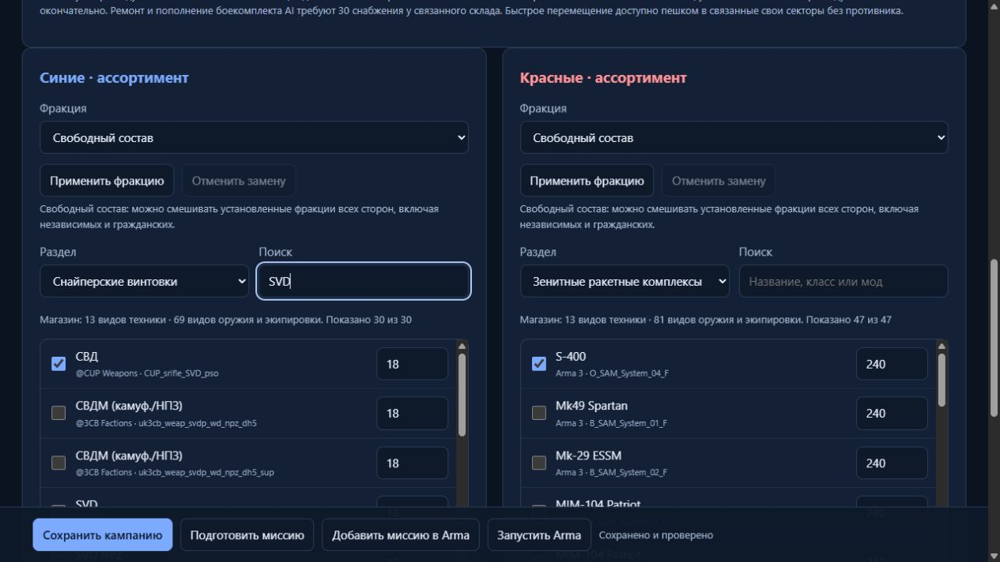
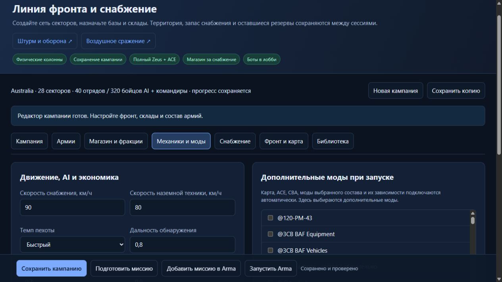

# NeroAI Operations: расширенная кампания и редакторы, 12.10.2026

Реализация внесена в `C:\Users\Admin\Desktop\ИИ\NeroAI_Warlords_DualLLM`. Три свежие миссии Australia собраны, установлены и побайтово сверены с исходниками. Интерфейс редактора и сохранение настроек проверены. Игровая приёмка этих пакетов ещё не выполнена: Arma агентом не запускалась.

## Открыть редактор и миссию

Редактор готовой кампании: [Australia — фронт и снабжение](http://127.0.0.1:18789/campaign?id=823be410-f43e-4cb7-ab58-344b1c23cc07). Воздушный редактор: `/operations`, наземный: `/ground` на том же порту. Помощник `control-center/operations-start.ps1` выбирает сервис `campaign-expanded-v3` и открывает его фактический порт. Старые страницы переадресуют в свежий редактор.

Запись расширенной кампании: `823be410-f43e-4cb7-ab58-344b1c23cc07`, revision 5, отдельный campaignKey `31d4fefe-48b8-4b12-bf05-47d1d7e0bb72`. Старая пользовательская запись сохранена отдельно. После изменения настроек нажать «Сохранить кампанию», затем «Добавить миссию в Arma». «Запустить Arma» использует моды сохранённой конфигурации; установленные обязательные зависимости подключаются автоматически.

В игре: «Мультиплеер → Создать сервер → Australia», выбрать свежую миссию с пометкой `[EXPANDED]`. Для кампании — первый командир синих; для воздушного сражения — первый пилот синих, F/A-18E. В лобби по 20 командирских/пилотских мест каждой стороны. Лишние места AI включаются и выключаются штатно в лобби. Если список миссий закэширован, переключить карту и вернуться на Australia.

## Что изменено

| Возможность | Реализация и настройки готовой Australia |
|---|---|
| Захват | Любая соседняя зона без голосования. Требуется связь соседнего своего сектора с базой, присутствие живых бойцов и отсутствие противника. Стоимость захвата в готовом пресете — 0; время — 120 секунд. |
| Фронт | 28 секторов; редактируемая сеть до 64 секторов и 192 связей. Отрезанные склады прекращают производство. Победа — захват базы противника. |
| Армии | 20 мест на сторону, 20 начальных отрядов каждой стороны, по 8 AI в отряде плюс командир; конечный резерв. Численность и состав задаются отдельно от лобби. |
| Движение | Грузовики — ограничение скорости 90 км/ч, наземная техника — 80, пехота — быстрый темп. Скорости настраиваются 20–120 км/ч. Это команды AI и пределы скорости, фактическая скорость зависит от машины, дороги и боя. |
| Навыки AI | Дальность и скорость обнаружения, смелость, командование и перезарядка доступны отдельно. Приказы игрока и High Command защищены от автоматического назначения задач. |
| Парк снабжения | По 6 начальных грузовиков, общий предел до 10 на сторону. Выживший грузовик возвращается и используется повторно. Потерянный можно купить за 70 снабжения; цена настраивается. |
| Доставка | Физический груз и конечные запасы. Доставка/потеря учитываются однократно; покупка грузовика не создаёт бесплатный груз. AI заменяет потери с оплатой и паузой. |
| Обслуживание | Вызов снабжения к своей технике в связанном своём или захваченном секторе. Обслуживание — 30 снабжения, остановленная и приземлённая техника, отсутствие врага рядом, пауза между обслуживанием. Боекомплект восстанавливается на владельце машины/турелей. |
| Магазины | Техника, авиация, оружие, боеприпасы, экипировка, грузовик снабжения, отдельное подкрепление и обслуживание оплачиваются реальными запасами. Цены и ассортимент редактируются. |
| Авиация отряда | 1–2 существующих бойца отделяются в группу пилотов. На земле остаётся минимум два бойца; наземная часть продолжает действовать самостоятельно. У отряда одновременно до одной обычной наземной машины и одного борта. |
| Баланс поддержки | В готовой кампании на сторону: 3 зенитные установки, 2 ЗРК, 1 РЛС, 3 артиллерийских орудия, 1 РСЗО; параметры редактируются. Общий предел — 20 наземных машин и 4 борта, 150 заказов за кампанию, пауза AI 90 секунд. |
| Беспилотники | Штатные виртуальные экипажи; сторона группы согласуется с покупателем. ЗРК/РЛС с беспилотным экипажем используют тот же корректный путь. |
| Отдельные подкрепления | Покупка за 50 снабжения и расход резервов; отдельные группы управления, предел готового пресета 6 на сторону. Управление через штатный High Command, обычно Ctrl+Space; группы привязаны к UID командира и возвращаются после переподключения/возрождения. |
| Быстрое перемещение | Пешком в связанные свои секторы без противника; повторная проверка перед перемещением. |
| HUD | Компактная информационная панель по центру сверху, скрывается при открытом меню, карте, Zeus или дистанционном управлении. Есть действие переключения. |
| Zeus | Во всех трёх новых Operations: все загруженные аддоны, редактирование техники/пехоты/объектов и штатных атрибутов, погоды, времени и эффектов, без цены и границ. Сохраняется назначение после возрождения. Дополнительный Zeus Enhanced выбирается как мод. |
| ACE и перегрузки | ACE/CBA обязательны. Отдельный обработчик перегрузок AI применяет физику, коэффициенты костюма и пороги ACE к локальным AI в самолётах и вертолётах. Игрок и управление Zeus не перехватываются; раненого AI обработчик принудительно не будит. |

AI не перебирает весь огромный магазин в каждом отряде: при сборке формируется ограниченный список кандидатов, до четырёх на категорию. Покупки учитывают имеющийся состав, бюджет, свободные экипажи, резервы, паузы и конечное число заказов. Артиллерия получает отдельный расчёт, работает по обнаруженным целям с паузой между залпами. Исчерпание боевого боекомплекта учитывает турели и пилоны, исключает клаксоны, лазеры и средства противодействия; авиация возвращается, наземная техника запрашивает обслуживание. Реальное поражение целей и возвращение нужно проверить в движке.

## Каталоги, фракции и моды

Свободный состав позволяет выбирать любую доступную установленную технику из каталога всех сторон, включая независимых и гражданских, без прежнего лимита выбранных позиций. Каноническая фракция — отдельный режим подбора техники и пехоты. Каталог содержит 21 009 позиций техники и 25 066 позиций оружия/боеприпасов/экипировки; это установленный контент, а не обещание совместимости каждого класса с любым игровым режимом.

Оружие разделено на ручные ракетные комплексы, пистолеты, снайперские винтовки, пулемёты, пистолеты-пулемёты, автоматы/карабины и винтовки. Отдельно находятся снаряды техники/артиллерии, ракеты, гранаты/взрывчатка и стрелковые магазины. Техника: транспорт, БТР/БМП, танки, самолёты, вертолёты, самоходная артиллерия, орудия/миномёты, беспилотники, зенитные установки, ЗРК, РЛС, РСЗО, станковое оружие и корабли.

Названия берутся из конфигураций и таблиц строк установленной Arma/модов, с предпочтением русского и резервом английского. Обработаны 2 705 таблиц и 87 780 строк, включая бинарный формат BLMX. Исправлена нечувствительность свойств и классов Arma к регистру: СВДМ/СВДС больше не наследуют ошибочную подпись АК-74, старые выбранные CUP-классы сохранены. Исправлена категория ЗРК: лазерный целеуказатель больше не попадает туда из-за подстроки `tor_` в `Designator`.

Вкладка «Механики и моды» содержит дополнительный набор модов. Карта, ACE, CBA, поставщики выбранной техники/оружия и их обязательные зависимости добавляются автоматически. Необязательные моды можно включать отдельно. Для воздуха/земли такой же выбор доступен в редакторах. Произвольные пути и неизвестные моды сервер отвергает. Отключение обязательного поставщика требует сначала убрать соответствующие классы из состава.





## Готовые пресеты всех установленных карт

Кнопка «Загрузить готовый пресет этой карты» находится во вкладке «Кампания». По одному готовому пресету для каждой из 22 карт; конфигурации также сохранены в `dist/operations-expansion-20261012/map-presets.json`. Это готовые конфигурации редактора. PBO для всех карт массово не устанавливались: пользователь выбирает карту и добавляет нужную миссию в Arma.

| Карты | Секторов в каждом пресете |
|---|---:|
| Altis, Australia, Sanagasta Argentina | 28 |
| Archie Summer, Archie Winter, Chernarus, Enoch, Farabad, Fjord, Isla Pera, Malden, Takistan, Tanoa, Uzbin Valley, Vereskovo, Virolahti | 22 |
| Stratis, Bastek, Lybor, Lybor Winter, Posadkovo | 14 |
| Walzton USA | 8 |

Центры секторов учитывают извлечённую геометрию дорог, где она доступна; проверены границы, отсутствие наложений и связность графа с ограничением длины связей. Граф секторов не доказывает физическую проходимость каждого маршрута дорог, особенно на островных картах. Грузовики используют дорожный поиск и могут ждать при отсутствии маршрута. Посадка самолётов использует штатные ILS карты; необходимо проверить доступность аэропорта и обслуживания в контролируемом секторе.

## Установленные пакеты и сохранность

Все три находятся в `H:\SteamLibrary\steamapps\common\Arma 3\MPMissions`:

| Название в Arma | Файл | SHA256 |
|---|---|---|
| NeroAI — Australia: фронт и снабжение [EXPANDED] | NeroAI_Frontline_Australia_8df4f05aace6.australia.pbo | 3A412BFE7DDA470EFF4A76168984BE7941CBF07075FA98434024E33EA9CE9C20 |
| NeroAI — Australia: воздушное сражение [EXPANDED] | NeroAI_AirBattle_Australia_f65b75a178d7.australia.pbo | 2430E23AFB33C58A977613EC8DB4452342BACD9FC9CABB52AF23EC5F32CC2AFE |
| NeroAI — Australia: штурм и оборона [EXPANDED] | NeroAI_AssaultDefense_Australia_78ae5fdd0fd9.australia.pbo | F2742FAC41D69EA6B146CFB87E3F48349BF28817444CEEA88BDA56C4E24665C2 |

Кампания — 64 файла / 58 SQF-функций; воздух — 28 / 22; земля — 22 / 16. В каждом пакете 40 игровых мест. Проверены контрольная сумма, манифест, каждый файл установленного PBO и равенство упакованной конфигурации текущей нормализованной записи редактора. Доказательства: `dist/operations-expansion-20261012/final-evidence.json`, `delivery.json`, `*-installed.json`.

Из списка миссий убраны 30 прежних дублей и ещё 7 промежуточных пакетов текущей разработки: всего 37 файлов в восстанавливаемом архиве `backups/scenarios/`. Каждый архивный PBO повторно сверён по SHA256; в MPMissions осталось 10 свежих NeroAI-сценариев, по одному на семейство/карту/режим. Другие карты и режимы Warlords сохранены. Будущая установка автоматически архивирует старый пакет своего семейства; при работающей Arma очистка откладывается. Архивирование проверяет реальные пути, процесс игры и неизменность исходного файла до удаления из списка миссий.

Для восстановления найти запись в `backups/scenarios/<время>/manifest.json`, проверить SHA256 её `archiveFile`, затем при закрытой игре скопировать PBO обратно в MPMissions. Нельзя восстанавливать старую миссию поверх новой без отдельного решения; архив доступен для отката и сравнения.

Пользовательская кампания `5fbba839-4303-4b7d-bdc5-7ca7441cfb77`, revision 7, 11 секторов, не изменена. SHA256 JSON: `02E7194AF465AB52D359AE8E0E26D84CF87120FBD0D9C0ADB4AB6290E0EFF33E`. Расширенная копия имеет отдельный ключ прогресса. Приватный `profiles.json` не записывался этими доставками; его текущий хэш до и после финальной доставки одинаков: `E1DC16DDA363A39B38CD08093EAB046FDC67F0AD226B215DD1146169731C2E14`. Прежний хэш ранней сессии изменился вне этих доставок; он не выдаётся за текущий.

Workshop и активный addon не перезаписывались. Старый сервис Operations оставлен отдельно после прежнего автоматического отказа остановки; свежий сервис работает на 18789 и перезапускался только после проверки своей принадлежности и отсутствия активной сборки.

## Проверки и реальные пределы готовности

- Operations: 45/45, `dist/operations-expansion-tests.log`.
- Основные тесты мода: 83/83, `dist/operations-expansion-mod-tests.log`.
- Control Center: 58/58, `dist/operations-expansion-control-tests.log`.
- SQF-VM: кампания 58 разобранных файлов / 95 утверждений чистых функций; воздух 22 / 255; земля 16 / 22. Всего 372 утверждения; команды движка Arma не выполнялись.
- Проверены все 22 пресета, большие наборы техники/экипировки без прежних лимитов, закрытый список модов и зависимости, граничные параметры, восстановимый архив и отказ очистки при игре, декодирование BLMX, правильные имена RHS, отсутствие целеуказателей в ЗРК и ограниченный список покупок AI.
- В браузере проверены новые вкладки, категории и цены, правильные СВДМ/СВДС/ЗРК, изменение скорости с сохранением и восстановлением, включение/выключение дополнительного мода, повторное открытие записи. Консоль свежей страницы без ошибок. Итоговая запись revision 5 согласована с PBO.

Сохранение стратегическое: территория, экономика, резервы/состав групп, оплаченный парк техники, боекомплект и пилоны, парк грузовиков, активные доставки и принадлежность отдельных подкреплений. Это не полная запись мира: произвольные объекты Zeus, личная экипировка и ранения каждого бойца, погода/время не воспроизводятся как полный снимок. Смена существенных правил создаёт новую область сохранения; исправления кода и переименование сохраняют прежнюю совместимую область. Готовая расширенная копия не продолжает автоматически старую пользовательскую кампанию.

Не подтверждены в свежем движке: реальные маршруты колонн, посадка и обслуживание авиации, применение ЗРК/РЛС/РСЗО по целям, управление High Command после возрождения, визуальные эффекты перегрузки AI и сетевые эффекты Zeus. Успешная сборка и чистые тесты не закрывают эти пункты.

## Игровая приёмка следующего этапа

1. Запустить свежую `[EXPANDED]` с модами редактора, сохранить RPT и подтвердить фактический пакет. Проверить 20 мест каждой стороны и ручное включение AI в лобби.
2. За командира купить оружие/экипировку и наземную технику: один заказ, одно списание со склада, корректная сторона/экипаж. При недостатке снабжения покупка должна отказать без спавна.
3. Купить грузовик снабжения, вызвать доставку к своему захваченному сектору. Проверить фактический проезд, доставку однократно, возврат/повторное использование; уничтожить груз и проверить окончательный расход, затем оплатить замену. Парк не превышает 10.
4. Потратить боекомплект машины и вызвать снабжение в связанном своём секторе: списание 30, реальный боекомплект владельца всех турелей/пилонов, отсутствие бесплатного повторного обслуживания. Проверить удалённого владельца в мультиплеере.
5. Вызвать отдельное подкрепление, перейти в High Command, выдать самостоятельный приказ. Проверить расход 50 и резерва, отсутствие перехвата приказа AI, возврат групп тому же UID после смерти/подключения.
6. Проверить соседние направления: захват любого соседнего сектора без голосования, остановка при присутствии врага, запрет изолированного направления. Проверить быстрый переход и повторную проверку противника.
7. Наблюдать покупки обеих сторон: одновременно действуют наземная часть и отдельные пилоты, поддержка остаётся в установленных пределах, артиллерия стреляет по обнаруженным целям, техника движется и используется. Отдельно проверить ЗРК/РЛС и виртуальные экипажи.
8. Сохранить и перезапустить кампанию: стоимость потерь, резервы, парк грузовиков, оплаченные экипажи/техника и High Command восстановлены без бесплатного пополнения. Проверить фактическое имя области сохранения.
9. В Zeus изменить время, погоду, эффект и свойства техники/пехоты, проверить подключение второго клиента/возрождение и свежий RPT без запретов remoteExec. Возможность пилонов зависит от самого класса техники.
10. В воздухе проверить прежний шлемный HUD F/A-18E и перегрузки AI на манёвре с ACE, включая многопользовательского владельца самолёта. Собрать наблюдения и свежие ошибки RPT, не оценивать поведение только по записи выдачи приказа.

## Продолжение для следующего агента

Рабочая папка — `C:\Users\Admin\Desktop\ИИ\NeroAI_Warlords_DualLLM`, не исторический cwd 4.2 и не Antistasi 5.0. Прочитать эту инструкцию, `AGENT_GUIDE_CURRENT_RU.md`, `CURRENT_STATUS.md` и актуальные правила проекта. Сначала сверить свежие процессы/RPT, запись редактора, исходники, PBO и установленный файл. Не выводить секреты profiles/bridge config. Не запускать и не завершать Arma без прямой команды пользователя, не перезаписывать Workshop. Спецоперации/HVT были остановлены пользователем: не возобновлять автоматически.

Шаблоны: `tools/campaign-assets`, `tools/operation-assets`, `tools/ground-assets`, общий Zeus/G-force — `tools/operation-common`. Данные и правила редактора: `control-center/campaign-operations.js`, `campaign-gameplay.js`, `campaign-equipment.js`, `campaign-presets.js`, `operation-mods.js`; UI — `campaign.html`, `campaign-ui.js`, `operation-mods-ui.js`. Сканер: `tools/scan-campaign-equipment.js`, строки: `resolve-asset-names.js` и `read-binary-stringtable.js`. Сборка/доставка: `control-center/operation-build.js`, `tools/deliver-operation-expansion.js`; архив: `control-center/scenario-archive.js`.

Команды из рабочей папки:

```powershell
npm run test:operations
npm test
npm run test:control
node tools/verify-operation-sqf.js --campaign
node tools/verify-operation-sqf.js
node tools/verify-operation-sqf.js --ground
```

`node tools/deliver-operation-expansion.js --prepare` обновляет файл готовых пресетов и использует уже созданные отдельные записи из `records.json`. Вариант без `--prepare` пересобирает и устанавливает эти три миссии с проверкой исходной пользовательской кампании и архивацией дублей; запуск игры не выполняется. Перед новой доставкой проверить реальную закрытость игры и соответствие поручению пользователя.

Готовое поручение для продолжения:

> Проверь свежую игровую приёмку Operations EXPANDED в NeroAI_Warlords_DualLLM по OPERATIONS_EXPANSION_2026-10-12_RU.md. Захват любой соседней зоны без голосования. Сначала сопоставь RPT, исходники, текущие записи редактора и установленные PBO с final-evidence.json. Исправляй только воспроизводимые ошибки; сохраняй исходную кампанию revision 7, приватные профили, оплаченные запасы, приказы игрока/High Command и отдельные проекты. Не возобновляй остановленные спецоперации и не управляй процессом игры без отдельной команды. Проверяй фактическую доставку, использование техники, обслуживание, продолжение, полный Zeus и перегрузки AI; успешные тесты и упаковку отмечай отдельно от наблюдений в Arma.

## Первичные источники

Сетевое исполнение и наследование конфигурации сверялись по [CfgRemoteExec](https://community.bistudio.com/wiki/Arma_3_CfgRemoteExec) и [import](https://community.bistudio.com/wiki/import_%28Config%29); штатное управление группами — [High Command](https://community.bistudio.com/wiki/Arma_3%3A_High_Command), локальность боекомплекта — [setVehicleAmmo](https://community.bistudio.com/wiki/setVehicleAmmo). Физика и пороги AI сверены с фактически установленным исходником `ace_gforces.pbo`; таблицы названий — с установленными конфигурациями и [ACE Realistic Names](https://ace3.acemod.org/wiki/feature/realisticnames). Общая политика содержит 145 именованных native RPC и сохраняет сетевые функции модов; собственные заявки используют проверки владельца и не сохраняются как JIP.
